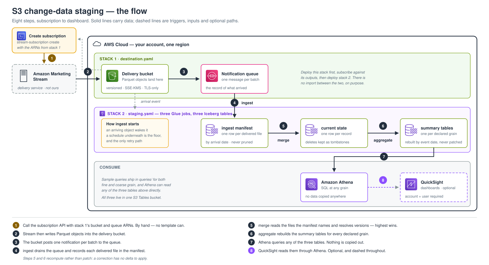

# S3 change-data reference application

Turn Amazon Marketing Stream S3 deliveries into a correct, queryable table.

[](LICENSE)
[](pyproject.toml)

Stream writes Parquet into your S3 bucket and posts a notification per batch. Those deliveries
**cannot simply be added up**: a correction for an event can arrive up to 70 days later, carrying
a replacement for a row you already have. Add them and every total is wrong.

This application resolves that into one row per record, queryable in Athena at any grain.



> A reference implementation, not the only correct way to do this. It may change and may not stay
> backwards compatible. [`docs/verification.md`](docs/verification.md) records exactly what is
> proven and what is not. The whole path — subscription delivery through to the dashboard — has
> been deployed end to end against real delivered data. What that deploy did *not* exercise is
> listed in `docs/verification.md` rather than summarised here.

## Prerequisites

| | Why |
|---|---|
| An AWS account and credentials that can deploy the stacks | CloudFormation, named IAM, S3, SQS, KMS, Glue, S3 Tables |
| [AWS CLI](https://docs.aws.amazon.com/cli/latest/userguide/getting-started-install.html), configured | Every deploy step shells out to it, so each command is reproducible by hand |
| Python 3.10+ | Builds the package the Glue jobs import |
| A Stream **client id and access token** | Creating a subscription is an API call; nothing here can mint these for you |
| Node.js 18+ and the AWS CDK CLI | Only for `ENGINE=cdk` |

The **S3 Tables integration must be enabled once per account and region**, or every table
reference fails. `make deploy-destination` does it for you.

## Quickstart

```bash
git clone https://github.com/amzn/ads-advanced-tools-docs.git
cd ads-advanced-tools-docs/amazon_marketing_stream/stream-s3-reference-application

python3 -m venv .venv && source .venv/bin/activate
python3 -m pip install -r requirements.txt && python3 -m pip install -e .
python3 -m pip install build          # make deploy-staging builds the Glue wheel
```

Then your Stream credentials, used by the subscription step only:

```bash
export AMAZON_ADS_CLIENT_ID=<Login with Amazon client id>
export AMAZON_ADS_ACCESS_TOKEN=<bearer token — expires in about an hour>
```

The token expires, so this is a step you repeat rather than a value you store.
[`docs/deploy.md`](docs/deploy.md#mint-an-access-token) has the exchange.

## Deploy

Choose the geography that owns the advertiser account and a region it permits — the deploy refuses
an invalid pair. Pick **one** engine and use it on every command, because `make verify` and
`make undeploy` use it to find the right stack.

**CDK** (recommended). Bootstrap each account and region once:

```bash
python3 -m pip install -r infrastructure/cdk/requirements.txt
make bootstrap REGION=eu-west-2
make deploy-all ENGINE=cdk GEO=EU REGION=eu-west-2
```

**CloudFormation.** No bootstrap, but the staging and QuickSight templates exceed the 51,200-byte
inline limit, so name an existing bucket in the same region:

```bash
make deploy-all GEO=EU REGION=eu-west-2 TEMPLATE_BUCKET=<existing-bucket>
```

Add `DEPLOY_ARGS=--dry-run` to any deploy command to print the plan without touching AWS.

### Start delivery

Deployment creates empty infrastructure. This step is deliberately separate: it starts real
advertiser data flowing.

Three things go into a subscription — the advertiser account to subscribe, and the two ARNs the
feed writes into.

**1. The advertiser account id.** Query it from the Ads API; nothing here can derive it. Take the
path, body and response shape from
[QueryAdvertiserAccount](https://advertising.amazon.com/API/docs/en-us/api-spec-v1-advertiseraccounts#tag/AdvertiserAccounts/operation/QueryAdvertiserAccount)
— this application does not call that endpoint, so the specification is the only authority for it.
The headers are the same three every Ads API call takes:

```bash
-H "Amazon-Ads-ClientId: $AMAZON_ADS_CLIENT_ID"
-H "Authorization: Bearer $AMAZON_ADS_ACCESS_TOKEN"
-H "Content-Type: application/json"
```

The id it returns looks like `amzn1.ads-account.g.<opaque>`.

**2. The bucket and queue ARNs.** The destination stack publishes both as outputs:

```bash
aws cloudformation describe-stacks --region eu-west-2 \
  --stack-name stream-destination \
  --query "Stacks[0].Outputs[?OutputKey=='DeliveryBucketName'||OutputKey=='NotificationQueueArn']" \
  --output table
```

**3. Create the subscription.** The CLI reads both ARNs out of the stack, so there is nothing to
copy by hand and nothing to get wrong:

```bash
stream-subscription --accounts <advertiser-account-id> create --geo EU --region eu-west-2
```

It calls [CreateStreamSubscription](https://advertising.amazon.com/API/docs/en-us/api-spec-v1-streamsubscriptions#tag/StreamSubscriptions/operation/AdsApiv1CreateStreamSubscription)
once per dataset. The equivalent raw call, if you would rather not use the CLI:

```bash
curl -X POST https://advertising-api-eu.amazon.com/adsApi/v1/create/streamSubscriptions \
  -H "Amazon-Ads-ClientId: $AMAZON_ADS_CLIENT_ID" \
  -H "Authorization: Bearer $AMAZON_ADS_ACCESS_TOKEN" \
  -H "Content-Type: application/json" \
  -d '{
        "accessRequestedAccounts": [{"advertiserAccountId": "<advertiser-account-id>"}],
        "streamSubscriptions": [{
          "description": "ads-performance-v1 to stream-destination",
          "destination": {
            "s3Destination": {
              "bucketArn": "arn:aws:s3:::<delivery-bucket-name>",
              "notification": {"queueArn": "<notification-queue-arn>"}
            }
          },
          "configuration": {"dataset": {"datasetId": "ads-performance-v1"}}
        }]
      }'
```

Pick the host for your geography: `advertising-api.amazon.com` for NA,
`advertising-api-eu.amazon.com` for EU, `advertising-api-fe.amazon.com` for FE. The destination
region has to be one your geography permits, and the deploy already refused an invalid pair.

**These endpoints answer `207 Multi-Status`, and the status line does not tell you whether it
worked.** Every operation is bulk-shaped, so a failure is reported per item inside the body. The
CLI reads the items and exits non-zero on a failed one; a raw `curl` needs you to read the body.

Data normally arrives within 1–2 hours, and the first delivery is a backfill of the dataset's
restatement period. Then:

```bash
make verify ENGINE=cdk REGION=eu-west-2
```

### Optional — QuickSight dashboard

Deploy after staging has created data. The stack owns its role, Athena workgroup, encrypted
buckets and its own Lake Formation grants.

**QuickSight signup is external** — it is account-level configuration and no template can do it.
[`docs/quicksight.md`](docs/quicksight.md) lists three further steps against the QuickSight
*service* role: authorising Athena, attaching `s3tables` read permissions, and a Lake Formation
grant. **Try the deploy first.** A live deployment now suggests none of the three is on the read
path, which is worth stating precisely because a wrong guess here costs hours:

- The Athena data source passes `AthenaParameters.RoleArn` naming the role this stack creates,
  which the CloudFormation reference says overrides the account-wide role. CloudTrail on that
  deployment bears it out: every `StartQueryExecution` ran as the stack's role, and the service
  role does not appear once. So authorising Athena and the `s3tables` policy, both of which apply
  to the *service* role, were not what made it work.
- The Lake Formation grant was a no-op in that account, because Lake Formation was not enforcing
  there: the catalog and both databases carried `IAM_ALLOWED_PRINCIPALS: ALL`, so IAM alone
  decided. An account with Lake Formation actually enforcing is a different situation and will
  need the grant.

Both findings are from watching what ran, not from removing the three and seeing it still work, so
they are evidence rather than proof. Reach for them if the dashboard reads nothing.

```bash
make deploy-quicksight ENGINE=cdk REGION=eu-west-2 QUICKSIGHT_USER_ARN=<arn>
```

Add `QUICKSIGHT_LF_PRINCIPAL_ARN=<iam-role-or-user-arn>` to have the stack make the Lake Formation
grant for a human principal too, so the same tables are queryable from the Athena console. It
takes an IAM ARN, not a QuickSight user ARN — Lake Formation rejects the latter as a data lake
principal, which a live deploy demonstrated.

Ten datasets and one dashboard. Seven read the pre-summed grain tables through SPICE; three read
current state directly, because the detail they carry exists at no coarser grain:

| View | Answers |
|---|---|
| Search terms, targets and placements | which term, against which target, in which placement, at which hour — one row, no join |
| Advertised ASIN and brand halo sales | what you advertised against what actually sold, with promoted and halo separated |
| The seven grain views | campaign, ad group, placement, device, geography, product and halo by day, plus campaign by hour |

Two properties to know before you share it:

- **No row-level security.** Sharing the dashboard shares every advertiser in the delivery.
- **The two current-state views sum money.** One delivery can carry advertisers budgeting in
  different currencies, and a sum over mixed currencies is a plausible invalid number. Scope or
  group by `budgetcurrency.value` before reading spend or sales. The grain views avoid this by
  reporting counts.

Ratios are calculated fields, never columns: a quotient stored as a column is averaged when the
dashboard filters, and averaging a ratio whose numerator and denominator sit on different rows
gives a wrong number with no error. [`docs/quicksight.md`](docs/quicksight.md) carries the
expressions.

## Cleanup

Cancel the subscription first, then let the jobs drain:

```bash
stream-subscription --accounts <id> list --geo EU
stream-subscription --accounts <id> delete --geo EU <subscription-id>
```

Preview a teardown, then run it:

```bash
make undeploy ENGINE=cdk REGION=eu-west-2 INCLUDE_QUICKSIGHT=yes \
  DEPLOY_ARGS='--dry-run --include-destination'

make undeploy ENGINE=cdk REGION=eu-west-2 INCLUDE_QUICKSIGHT=yes \
  DEPLOY_ARGS=--include-destination CONFIRM=yes
```

A plain `delete-stack` is not enough — CloudFormation refuses to delete non-empty buckets, and
disabling the schedules does not stop a job **already running**, which would recreate the tables
it just dropped. `make undeploy` disables the schedules, waits for in-flight runs, then deletes.
If a run is still going after `--drain-timeout-seconds` it refuses, having deleted nothing.
Deleting the destination stack **retains** the delivery bucket, access-log bucket, queues and key.
Omit `--include-destination` to rebuild processing while keeping delivered objects.

## What gets deployed

Two stacks, deliberately separate, so deleting the consumer can never delete your delivered data.

| Stack | Holds |
|---|---|
| **destination** | Delivery bucket, notification queue and DLQ, customer-managed KMS key, access logs, alarm topic, and every policy Stream needs |
| **staging** | S3 Tables bucket, Glue 5.0 jobs (one ingest; merge and aggregate per dataset), their schedules, the arrival trigger, an artifact bucket, and one alarm set per dataset |

Per dataset:

| Table | What is in it |
|---|---|
| `ingest.<dataset>_manifest` | One row per delivered file. Arrival index, deduplication record and provenance. Never pruned |
| `ingest.<dataset>_merged_objects` | Objects whose rows reached current state, so an old object cannot go missing |
| `current.<dataset>` | One row per record. **This is what you query.** Deletes are kept as tombstones |
| `ingest.<dataset>_pending_aggregation` | Event dates merge changed and aggregate has not rebuilt. An old row means aggregate is behind |
| `aggregate.<dataset>_<grain>` | Pre-summed per declared grain, for dashboard-speed answers |

**There is no copy of the delivered rows.** The objects in your bucket are that copy, so your
rebuild horizon is the bucket's lifecycle policy (`DeliveredObjectExpirationDays`, default: never
expire) — see [`docs/design.md`](docs/design.md#why-there-is-no-copy-of-the-delivered-rows).

## Datasets

Two ship configured; adding a third needs no code change
([CONTRIBUTING.md](CONTRIBUTING.md#adding-a-dataset)).

| Dataset | Grain | Backfill | Summary grains |
|---|---|---|---|
| `ads-performance-v1` | hourly | 10 days | `campaign_day`, `ad_group_day`, `campaign_hour`, `placement_day`, `device_day`, `geo_day` |
| `ads-converted-product-v1` | daily | 70 days | `campaign_day`, `product_day`, `halo_day` |

Both declare a **70-day restatement window**. Check `DeliveredObjectExpirationDays` against it:
expire objects sooner and corrections can arrive for events you can no longer rebuild.

Schedules rebuild only the event dates a merge touched. To rebuild one grain on demand:

```bash
stream-aggregate --dataset ads-converted-product-v1 --grain product_day --event-dates 2026-09-10
```

## Query it

Replace `<catalog>` with yours — for S3 Tables through Glue it is usually
`s3tablescatalog/<table-bucket-name>`.

```sql
-- Is the pipeline current?
SELECT count(*) AS rows,
       count_if(is_deleted) AS tombstones,
       max("streambatch.version") AS max_batch_version,
       max("date.value") AS latest_event_date
FROM "<catalog>".current.ads_performance_v1;

-- Numbers, at whatever grain you need.
SELECT "date.value", "campaign.id", sum("metric.clicks") AS clicks
FROM "<catalog>".current.ads_performance_v1
WHERE "date.value" = '2026-01-15'
  AND is_deleted = false
GROUP BY "date.value", "campaign.id";
```

Four properties affect every query:

- **`is_deleted = false` is not optional.** Tombstones are retained rows; including them adds
  deleted records to your totals with no error.
- **Rows are sparse, and an entity spans several of them.** Sum across all rows for an entity;
  do not pick "the row with the impressions".
- **Derived measures must aggregate their components first.** Return on ad spend is
  `sum(sales) / sum(cost)`, never `avg(sales/cost)`.
- **Treat every table as multi-tenant.** The delivery contract permits one file to carry
  records for several subscriptions, and the notification carries no subscription id — so
  isolation comes from `advertiseraccount.id`, not from separate files. A destination serving
  one subscription will show one advertiser per file; that is not evidence the contract
  property is absent, and filtering on the account id is required regardless.

More in [`queries/`](queries/) — pre-aggregated reads, fine-grain reads, the seven standard
advertising breakdowns, and reconciliation queries that check the coarse tables against current
state.

## Documentation

| | |
|---|---|
| [`docs/deploy.md`](docs/deploy.md) | Both engines step by step, artifact upload, troubleshooting |
| [`docs/design.md`](docs/design.md) | Why deliveries cannot be summed, and every correctness rule |
| [`docs/operations.md`](docs/operations.md) | Cost, rebuild horizon, replay, alarms, teardown |
| [`docs/verification.md`](docs/verification.md) | What is proven, how — and what is not |
| [`docs/quicksight.md`](docs/quicksight.md) | The optional dashboard |
| [`inspection/`](inspection/) | Query the raw deliveries directly, for when a number looks wrong |

## Cost

Everything is pay-per-use; nothing is left running idle. Largest drivers first: Athena scan volume
(query the coarse tables and always constrain `date.value`), Glue job time (three schedules — 5
min, 15 min, hourly), S3 storage, and S3 Tables maintenance. A delivery day of the hourly dataset
on the order of 3,000 objects holding 1,500,000 rows becomes around 900,000 rows of current state —
plan the first day heavier, because the backfill after subscribing is bigger than steady state.

## Development

```bash
pip install -r requirements-dev.txt
make check     # lint, types, templates, tests, hygiene scan — what CI runs
make           # list every target
```

CI installs from `requirements-lock.txt`: exact versions with hashes, for every supported Python.
After changing a dependency, run `make lock` (needs [uv](https://docs.astral.sh/uv/)).

Correctness rules live in pure Python under `src/stream_staging/transform/` and are tested without
a Spark cluster; the Spark modules are thin adapters. The same rules exist as generated SQL, and a
differential test runs both over the same deliveries and demands identical answers.

Read [CONTRIBUTING.md](CONTRIBUTING.md) before opening a pull request, and
[SECURITY.md](SECURITY.md) to report a vulnerability.

## Licence

[MIT-0](LICENSE).
